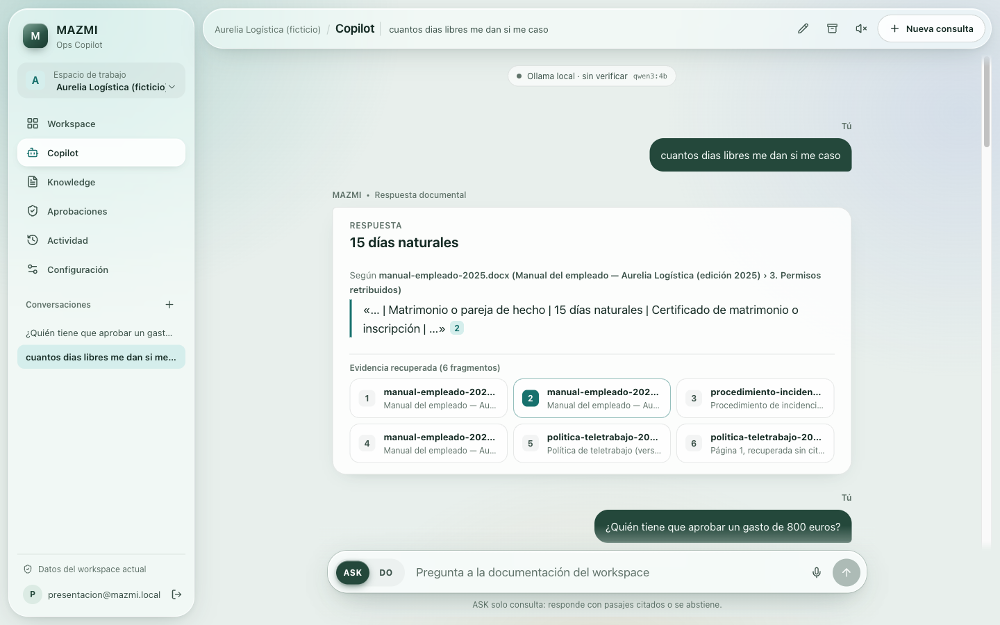
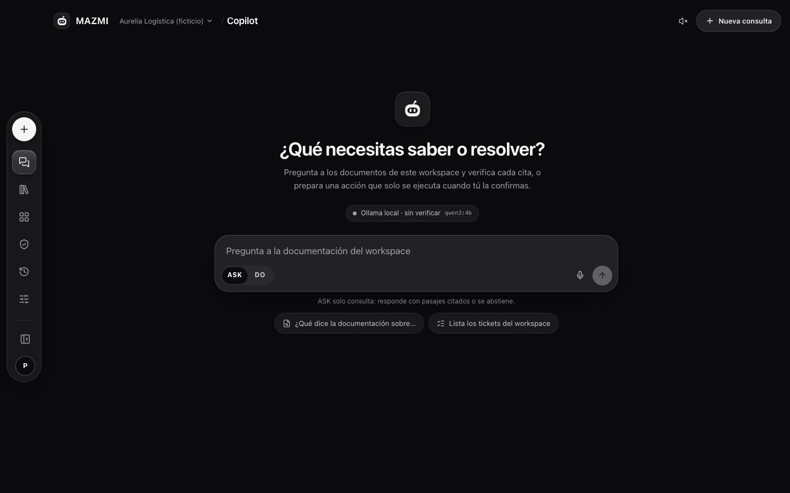
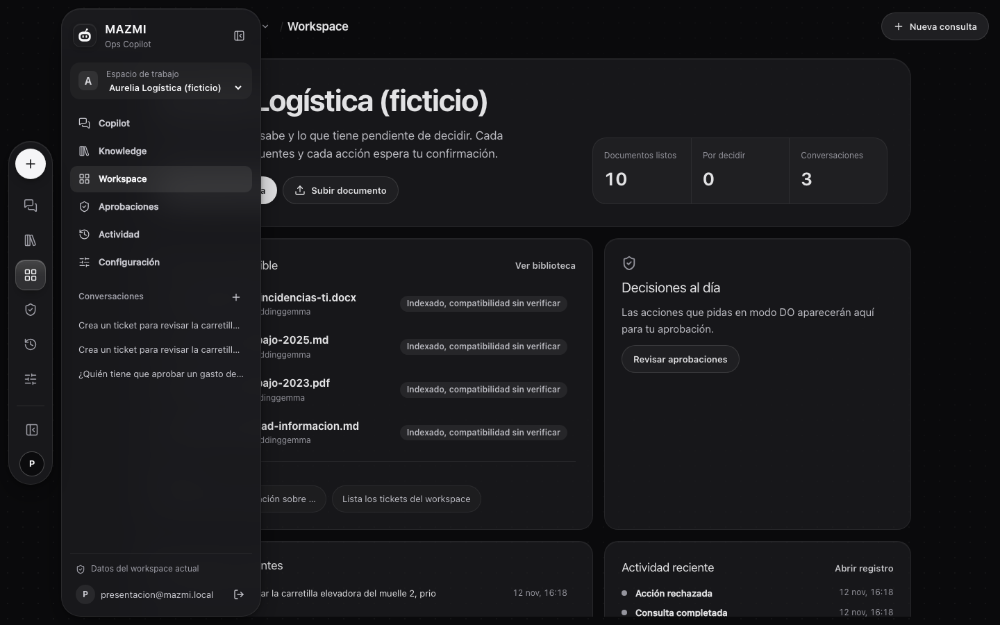
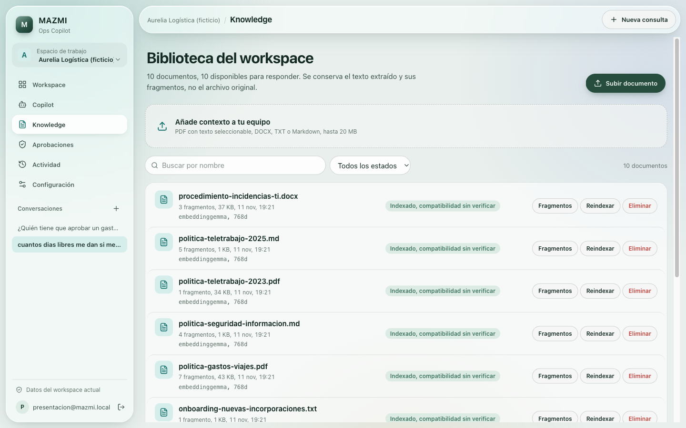
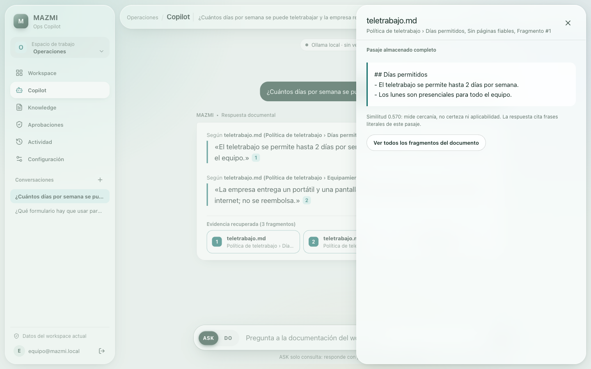
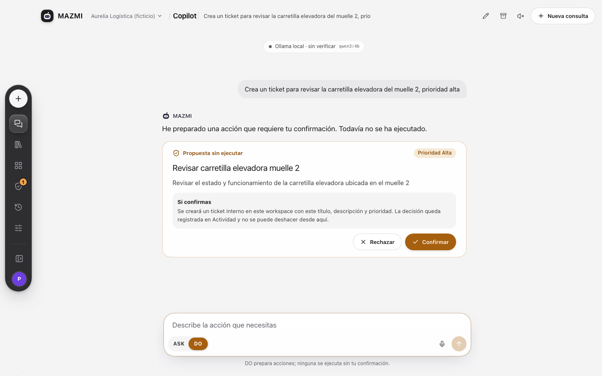
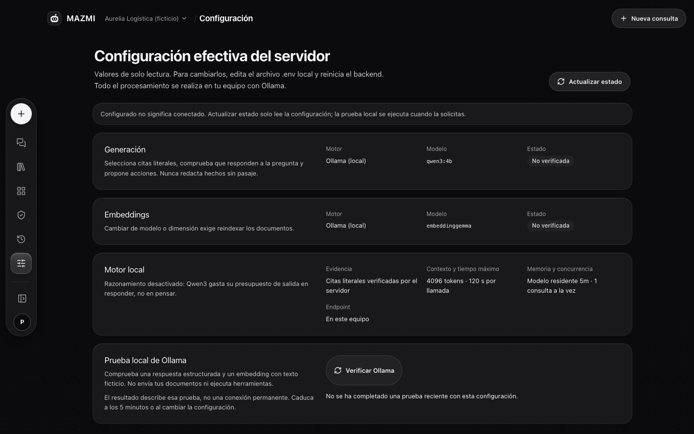
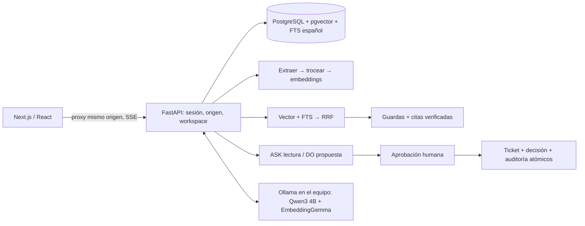

# MAZMI Ops Copilot

**Preguntas sobre los documentos de un equipo, con citas literales verificables, y acciones operativas que solo se ejecutan cuando una persona las aprueba. La IA se ejecuta en tu equipo con Ollama.**

[](https://github.com/LucaMZM/mazmi-ops-copilot/actions/workflows/ci.yml) [](LICENSE)

MAZMI responde con frases literales de los documentos subidos por el usuario, se abstiene cuando la evidencia no basta y prepara acciones (por ejemplo, un ticket) que **solo se ejecutan tras una confirmación humana**. Todo está aislado por workspace y queda en un registro de auditoría.

Pila: Next.js 16 / React 19, FastAPI, PostgreSQL 17 con pgvector y Ollama (Qwen3 4B + EmbeddingGemma). Pipeline RAG directo en Python, sin LangChain ni frameworks de agentes.

> **Estado:** funciona de extremo a extremo con modelos locales y base de datos reales; las cifras medidas, incluidos los fallos, están en [VALIDATION.md](VALIDATION.md). Qwen3 4B en un Mac de 8 GB es lento y conservador, así que **no hay etiqueta `v1.0.0`** (criterios y fallos abiertos en [VALIDATION.md](VALIDATION.md#criterios-de-aceptación-del-modelo-local)). No es un despliegue de producción.



| Inicio de una consulta | Panel de secciones e historial |
|---|---|
|  |  |

| Conocimiento | Inspector de evidencia |
|---|---|
|  |  |

| Aprobación humana | Configuración |
|---|---|
|  |  |

[Móvil](docs/screenshots/copilot-mobile.png) · [Procedencia de las capturas](docs/screenshots/README.md)

## Cómo responde

1. **Ingesta.** PDF, DOCX, TXT o Markdown de hasta 20 MB. El texto se divide por estructura (encabezados, párrafos, listas, filas de tabla) y cada fragmento guarda su sección.
2. **Recuperación.** Búsqueda vectorial exacta y texto completo en español, ambas filtradas por workspace, estado del documento y colección de embeddings; se fusionan con RRF y se limita a tres fragmentos por documento.
3. **Evidencia verificada.** Guardas deterministas comprueban alcance, hechos pedidos, condiciones y contradicciones literales. Después, el modelo copia una cita literal por cada parte de la pregunta; **el servidor verifica que cada cita existe en el pasaje que nombra**, y una segunda llamada acotada confirma que esas citas contienen el dato pedido. Cualquier fallo es una abstención.
4. **Respuesta.** El servidor muestra frases literales del pasaje almacenado, con documento, sección y un identificador de cita, precedidas de una línea breve con el dato cuando ese dato aparece tal cual en la cita. El texto que ve el usuario nunca lo escribe el modelo.
5. **Versiones.** Un documento que declara estar sustituido o fuera de vigor no se usa para preguntas sobre la situación actual; sí para preguntas sobre esa versión, indicándolo.

Los documentos son datos no fiables: las llamadas documentales no reciben herramientas y las llamadas con herramientas no reciben documentos ni historial.



## Seguridad

Sesiones opacas en cookies HttpOnly `SameSite=Strict` (almacenadas con hash), contraseñas scrypt, límite de intentos persistente, comprobación de origen en cada mutación, pertenencia al workspace verificada en el servidor en cada consulta, modelos Pydantic estrictos, errores del modelo sanitizados, CSP y cabeceras de seguridad, subidas y descompresión DOCX acotadas. ASK no puede modificar datos. DO solo crea una propuesta; solo quien la pidió, en el mismo workspace, puede decidirla, una única vez, y ejecución, decisión y auditoría se confirman juntas.

## Puesta en marcha (nativa, recomendada)

Requisitos: Python 3.13, Node.js 22+, PostgreSQL 17 con pgvector y [Ollama](https://ollama.com) con `qwen3:4b` y `embeddinggemma` ya instalados (la aplicación nunca descarga modelos). Mantén entornos virtuales, `node_modules` y clústeres de PostgreSQL fuera de carpetas sincronizadas (iCloud/Dropbox).

```bash
git clone https://github.com/LucaMZM/mazmi-ops-copilot.git
cd mazmi-ops-copilot
make setup          # venv, dependencias y .env a partir de .env.example
ollama list         # comprueba qwen3:4b y embeddinggemma
make check-local    # comprobación real de los modelos instalados
```

Edita `.env` con tu conexión a PostgreSQL (con la extensión `vector`). Antes de usar una base con datos, lee [database/MIGRATIONS.md](database/MIGRATIONS.md). Después, en dos terminales:

```bash
make backend        # migra y arranca FastAPI en 127.0.0.1:8000
make frontend       # Next.js en http://127.0.0.1:3000
```

Abre la aplicación, **crea tu cuenta**, sube tus documentos y pregunta. En *Configuración* puedes ejecutar «Verificar Ollama». Guía para enseñarlo: [docs/PRESENTACION.md](docs/PRESENTACION.md). Detalles del motor local, memoria y configuración: [LOCAL_AI.md](LOCAL_AI.md).

### Docker Compose (opcional)

`docker compose up --build` levanta PostgreSQL, backend y frontend. **Ollama no se ejecuta en Docker**: el backend usa el del equipo anfitrión mediante `host.docker.internal:11434`. El estado de esta vía está en [VALIDATION.md](VALIDATION.md#docker-compose-opcional).

## Pruebas

```bash
make backend-test      # ruff + pytest (la integración usa TEST_DATABASE_URL; sin ella se omite, no se da por pasada)
make frontend-check    # tipos, lint, pruebas y build
cd backend && python -m app.evaluate_local --live --cases evals/local_holdout_v3.json --output resultado.json
```

Las pruebas normales no llaman a ningún modelo ni descargan nada. Las evaluaciones con modelos reales son explícitas y se niegan a trabajar sobre una base que no sea nueva, vacía y dedicada.

## Resultados medidos (resumen)

Con Ollama real (Qwen3 4B + EmbeddingGemma) en un Mac de 8 GB y bases nuevas:

- **Corpus realista** (DOCX y PDF con tablas, dos versiones de una política, contrato): **15/15 en un conjunto reservado nunca visto**, 25/25 en el primer reservado y 35/35 en desarrollo. Todas las citas son literales y los 36 titulares mostrados son correctos.
- **Una cita literal no basta:** si la pregunta nombra a una parte (un cliente) y la evidencia habla de otra (lo que el transportista cobra a la empresa), se abstiene. Dos documentos con cantidades distintas para un mismo dato, aunque una esté escrita con letras, se tratan como conflicto.
- **Seguridad:** 13/13 recorridos en todas las ejecuciones.
- **Tiempos:** propuesta de ticket en unos 5 s; respuesta documental con mediana de 11 a 15 s; unos 3,7 GB de memoria en Ollama.
- **Fallos abiertos:** 2 de 20 respuestas sin soporte en el conjunto semántico reservado, por conflictos parafraseados sin cantidades. Es un límite medido de Qwen3 4B; no hay tag `v1.0.0`.

Tablas, intentos descartados y criterios: [VALIDATION.md](VALIDATION.md). Demostración en cinco minutos: [docs/PRESENTACION.md](docs/PRESENTACION.md).

## Límites conocidos

Corpus de evaluación pequeños y ficticios; sin benchmark de gran escala. Qwen3 4B se abstiene ante preguntas muy indirectas y tarda segundos o decenas de segundos en un Mac de 8 GB. Voz (Faster-Whisper/Piper) sin verificar. La indexación es síncrona (un trabajo interrumpido se marca como fallido al reiniciar). Sin correo de recuperación, invitaciones ni RBAC. Los controles frente a inyección de prompts reducen riesgos concretos; no son una garantía.

## Licencia

**Propietaria — todos los derechos reservados.** El código original es visible solo para evaluación de portafolio. Copiar, modificar, redistribuir o reutilizar comercialmente requiere permiso previo por escrito. Ver [LICENSE](LICENSE). Los componentes de terceros conservan sus licencias.
