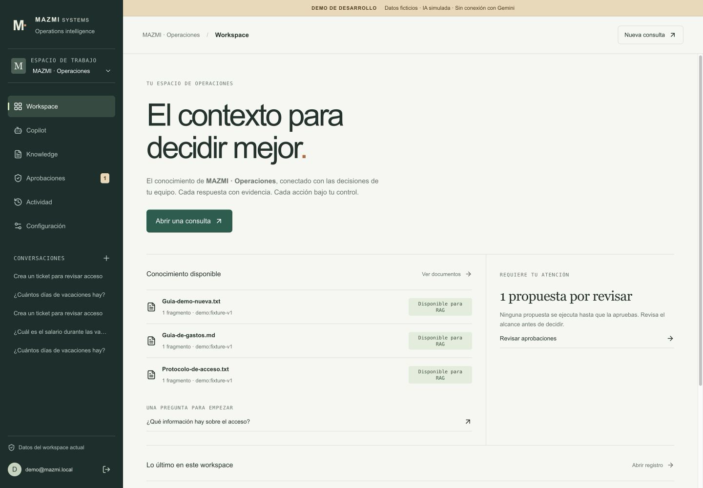
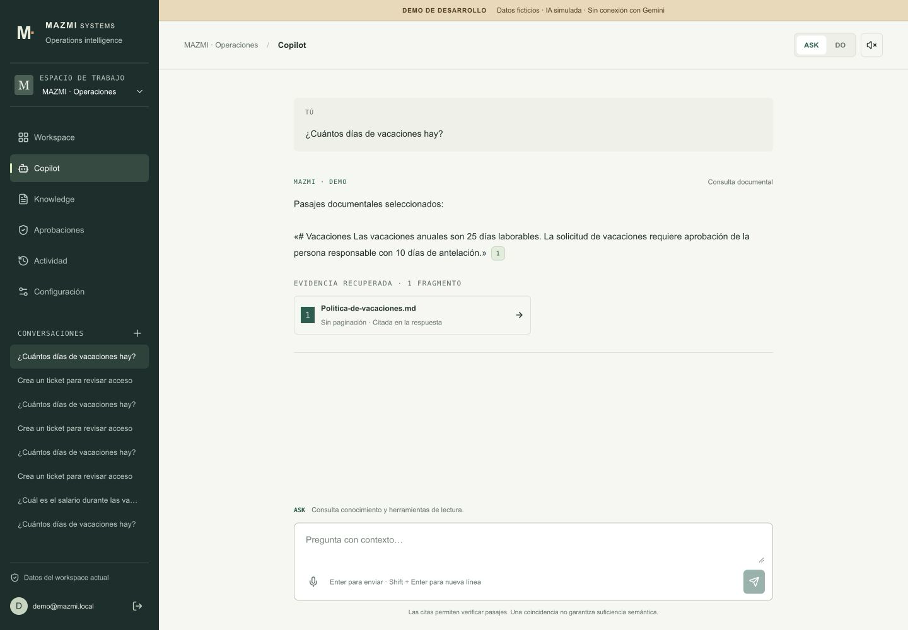
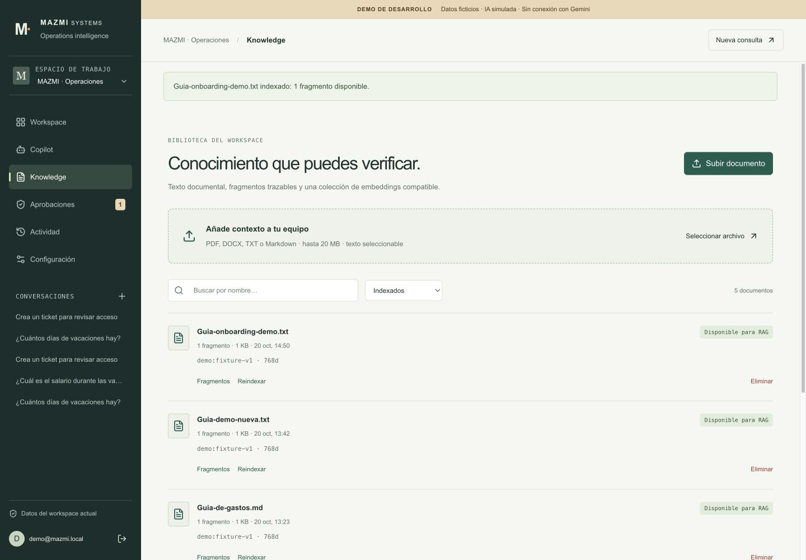
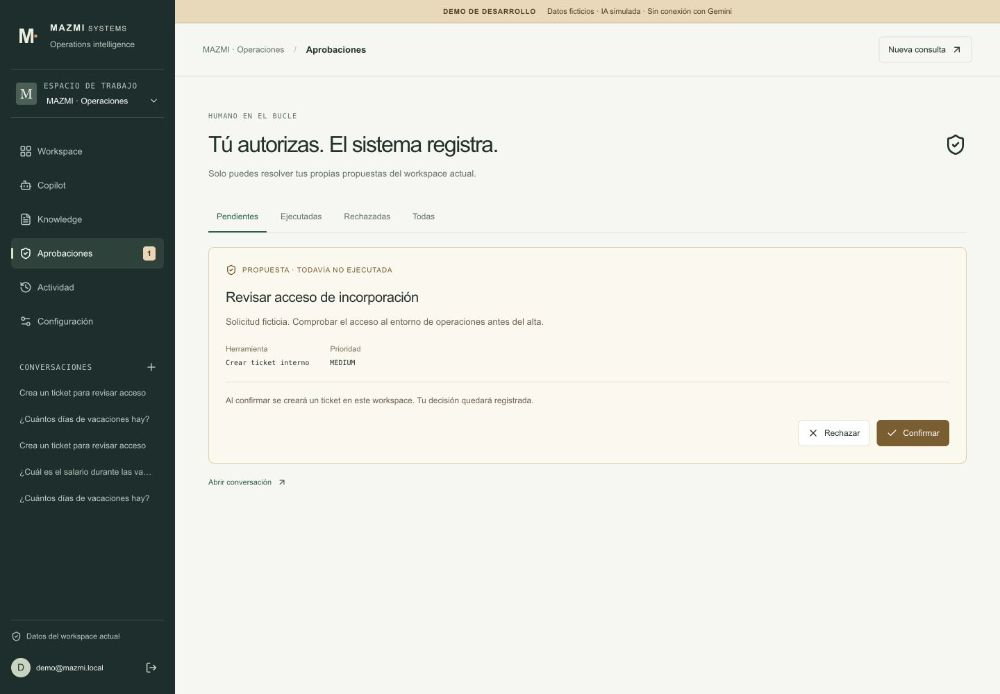
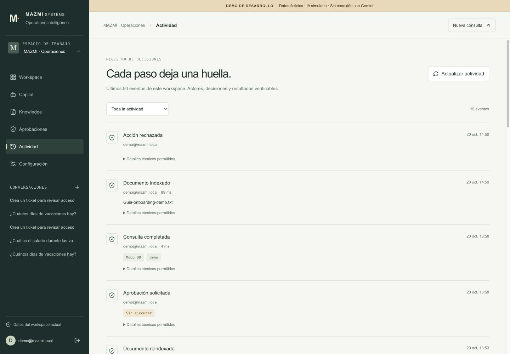
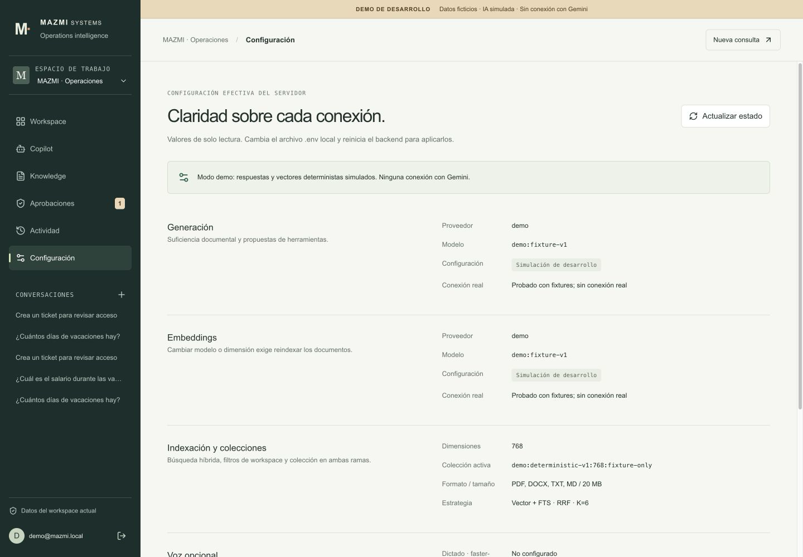
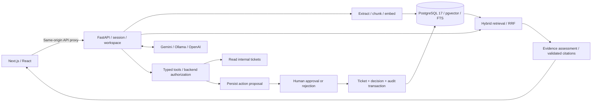

# MAZMI Ops Copilot

**Enterprise AI for document knowledge, evidence-backed answers and human-supervised actions.**

[](frontend/package-lock.json) [](frontend/package-lock.json) [](frontend/package-lock.json) [](backend/Dockerfile) [](backend/requirements.lock)
[](docker-compose.yml) [](docker-compose.yml) [](GEMINI.md) [](LOCAL_AI.md) [](backend/requirements.lock)
[](docker-compose.yml) [](.github/workflows/ci.yml)
[](https://github.com/LucaMZM/mazmi-ops-copilot/actions/workflows/ci.yml)

MAZMI connects the context a team already has with the decisions it needs to make. Ask a question, inspect the original supporting passage, or prepare an operational action for review. The boundary between **understanding** and **execution** stays visible.

Built as a working portfolio project with a direct Python RAG pipeline, real PostgreSQL persistence and a deliberately small tool surface. No LangChain, managed agent platform or mandatory paid service.

**Try it without an API key:** the [development demo](DEMO.md) uses clearly labelled deterministic fixtures. It runs the same authentication, document ingestion, hybrid retrieval, approvals and audit paths. It is not a Gemini quality demo or a publicly hosted service.

> **Validation boundary:** PostgreSQL/pgvector and browser journeys have been exercised locally. Provider SDK contracts are tested with simulated HTTP responses. Gemini, OpenAI, Ollama and real microphone/TTS operation still need live verification. This is a portfolio baseline, not a production deployment.

## Product

- **Workspace:** relevant documents, pending decisions and recent activity in one operating context.
- **Copilot:** ASK/DO, persistent conversations, SSE progress, recoverable errors and an evidence inspector. Documentary answers appear after evidence validation, rather than unchecked token streaming.
- **Knowledge:** PDF, DOCX, TXT and Markdown ingestion, indexing status, collection compatibility, explicit reindexing and document deletion.
- **Approvals:** visible scope and consequences; review, approve or reject your own proposed actions.
- **Activity:** workspace-scoped audit events for documents, queries, proposals and decisions.
- **Settings:** effective server configuration and honest provider states, without browser-side API keys or pretend connection checks.

The interface is in Spanish. Responsive layouts, keyboard navigation, focus management and reduced-motion styles are included.

## Screenshots

Real browser captures of the running development demo, using fictional data and deterministic AI. No generated mockups.




| Knowledge | Human approval |
|---|---|
|  |  |

| Activity | Settings |
|---|---|
|  |  |

[Mobile Copilot](docs/screenshots/copilot-mobile.png) · [Source inspector](docs/screenshots/source-inspector.png) · [Capture provenance](docs/screenshots/README.md)

## Architecture



Generation and embedding providers are independent. The browser only talks to the application backend. Opaque session cookies are HttpOnly/SameSite; the database stores token hashes. Passwords use scrypt, mutations check origin, and workspace membership is checked on the server.

## RAG: retrieval, evidence and citations

1. Validate the file and extract text. Files are limited to 20 MB; DOCX decompression and chunk counts are bounded. PDF chunks retain page metadata. DOCX/TXT/Markdown do not pretend to have reliable page numbers. Original uploaded files are not retained.
2. Split text with overlap, then embed in batches. Validate vector dimensions, cardinality and finite values before storage.
3. Retrieve cosine candidates and Spanish PostgreSQL Full Text Search candidates. Merge with Reciprocal Rank Fusion (`k=60`), deduplicate and select up to six chunks. Both branches enforce workspace, document state and embedding collection.
4. Assess evidence sufficiency using a structured provider response. The backend validates selected passage IDs, schema, scope, certain missing fact facets and literal contradictions. Retrieved documents are untrusted data.
5. Return **extractive quotations of stored chunks**, with server-created citation identifiers. The inspector exposes the preserved passage and its document/page metadata. A valid citation is not, by itself, proof of semantic sufficiency.

Vectors are separated by provider, model, dimension and revision; Ollama also includes its model digest. Switching embedding models requires explicit transactional reindexing. Equal dimensions do not make collections compatible. Reindexing failure preserves the previous vectors.

Vector search currently calculates exact distance inside the filtered collection. There is no additional reranker or large-scale ANN performance claim.

### Evaluation, without inflated claims

The reproducible small fixture evaluation uses real SQL and synthetic embeddings. Its recorded hybrid Recall@6 and MRR are both 1.0 on eight questions; this measures plumbing on that corpus, **not real model accuracy**. The adversarial grounding dataset records **14/15 correct abstentions**, with 0/4 false abstentions on answerable examples. One semantic relationship case remains unresolved: matching words can describe the wrong relationship when the mock evaluator lies.

See [validation and limitations](VALIDATION.md), [retrieval report](backend/evals/product-retrieval-results.json) and [paired grounding report](backend/evals/product-grounding-results.json). Historical before/after grounding observations are retained; they are not a benchmark of Gemini.

## ASK, DO and human control

**ASK** can answer documentary questions or explicitly read internal tickets. **DO** can also propose `create_ticket`. These are internal database tickets, not an external CRM integration.

The backend authorizes tools from the current user request and mode, validates arguments with Pydantic and rejects unauthorized provider calls. Document-answer calls have no tools; tool calls do not receive retrieved documents or conversation history. A document cannot grant capabilities.

A mutation first becomes a persisted proposal. Only the requesting user in that workspace can decide it. Approval revalidates the payload, locks the proposal and writes the ticket, decision and audit event in one transaction. Repeated approval returns 409. Rejection creates no ticket. SDK automatic function execution is disabled.

## AI providers

| Provider | Generation / embeddings | Verified status |
|---|---|---|
| Development demo | Deterministic topic fixtures / synthetic vectors | Real local browser and database journeys; no model calls |
| Gemini, default configuration | `gemini-3.5-flash-lite` / `gemini-embedding-2`, 768d | Official SDK contracts mocked; **live API pending** |
| Ollama, optional | `qwen3:4b` / `embeddinggemma`, 768d | Native API adapter mocked; local models not downloaded |
| OpenAI, optional | `gpt-5-mini` / `text-embedding-3-small`, 1536d | Adapter mocked; live API pending; may incur charges |

Gemini handles structured outputs, provider streaming, embeddings and function declarations through the official SDK. Quota errors are sanitized; 429 does not trigger an automatic retry, model switch or paid fallback. Actual access, free quota and model availability must be checked for your project. [Gemini setup and live smoke test](GEMINI.md).

No billing is enabled by this application. For a free cloud trial, use a project without billing and verify Google's current terms; an API key alone does not establish that requests are free. Use fictional documents when evaluating provider data handling.

Optional voice uses Faster-Whisper STT and Piper TTS, with OpenAI TTS available only when explicitly selected. Missing models, unsupported recording or denied microphone permission do not prevent text chat. Real voice is unverified. [Local AI and voice requirements](LOCAL_AI.md).

## Tech Stack

**Frontend**

[](frontend/package-lock.json) [](frontend/package-lock.json) [](frontend/package-lock.json)

**Backend**

[](backend/Dockerfile) [](backend/requirements.lock)

**Data**

[](docker-compose.yml) [](docker-compose.yml)

**AI / RAG**

[](GEMINI.md) [](LOCAL_AI.md) [](backend/requirements.lock)

**Testing and quality**

[](backend/requirements.lock) [](frontend/package-lock.json) [](backend/requirements.lock)

**Infrastructure**

[](docker-compose.yml) [](.github/workflows/ci.yml) [](https://github.com/LucaMZM/mazmi-ops-copilot/actions/workflows/ci.yml)

Versions come from the committed lockfiles and container definitions. Python 3.13 and PostgreSQL 17 are the declared runtime lines; the local validation used Python 3.13.7, PostgreSQL 17.11 and pgvector 0.8.6. The reproducible Compose/CI image pins pgvector 0.8.2. Ollama has no pinned server version. Docker badges describe container runtime targets, not a claimed Docker Engine version. The OpenAI badge uses a neutral connector glyph because its official icon is unavailable in Shields' icon set.

## Local setup

Prerequisites: Python 3.13, Node.js 22+, PostgreSQL 17 with pgvector installed, and enough disk space for dependencies and database migrations. Docker Compose is an alternative, not a requirement for native development.

```bash
git clone https://github.com/LucaMZM/mazmi-ops-copilot.git
cd mazmi-ops-copilot
python3.13 -m venv .venv
source .venv/bin/activate
pip install -r backend/requirements.lock
# Preserve an existing local configuration.
test -e .env || cp .env.example .env
cd frontend
npm ci
cd ..
```

Create a dedicated database with your local PostgreSQL tooling and set `DATABASE_URL` in the root `.env` to its actual connection string. The database owner needs permission to install the pgvector extension and apply the schema. Use a private local database password; the example value is a development placeholder.

**For the no-key demo, follow [DEMO.md](DEMO.md) before starting the backend.** Create a new database ending in `_demo`, set `APP_ENV=development` and `DEMO_MODE=true`, then run `python -m app.demo` from `backend`. The seed refuses populated databases before migration. It prints a newly generated password for `demo@mazmi.local` to your local terminal. Store it privately; there is no universal demo password.

For normal provider mode, leave demo disabled and configure the selected provider only in `.env`. Then, from the repository root:

```bash
# Terminal 1, virtualenv active
cd backend
python -m app.migrate
uvicorn app.main:app --host 127.0.0.1 --port 8000

# Terminal 2, from the repository root
cd frontend
npm run dev
# Or: npm run build && npm start
```

Open http://localhost:3000. The API documentation is at http://localhost:8000/docs and database health at http://localhost:8000/health. A missing provider key produces a controlled error; demo mode needs no external key.

### Environment

[`.env.example`](.env.example) documents all defaults. Never commit `.env` or paste keys into frontend variables.

| Variables | Purpose |
|---|---|
| `DATABASE_URL`, `POSTGRES_*` | Native connection / Compose database configuration |
| `APP_ENV`, `DEMO_MODE` | Production default / explicit isolated development demo |
| `GENERATION_PROVIDER`, `EMBEDDING_PROVIDER` | Independent `gemini`, `ollama` or `openai` adapters |
| `GEMINI_API_KEY`, `OPENAI_API_KEY` | Server-only optional credentials; blank in the example |
| `GEMINI_MODEL`, `GEMINI_EMBEDDING_MODEL` | Cloud model identifiers |
| `EMBEDDING_DIMENSIONS`, `EMBEDDING_REVISION` | Collection compatibility and deliberate reindexing |
| `BACKEND_URL` | Next.js API proxy destination; rebuild after changing it |
| `COOKIE_SECURE` | `true` for HTTPS deployments; local HTTP uses `false` |
| `STT_MODEL_PATH`, `PIPER_MODEL_PATH`, `TTS_PROVIDER` | Optional speech configuration |

Restart the backend after changing provider configuration. Settings reports configuration, not a live connectivity certification.

### Database and containers

Fresh databases use the ordered SQL migrations in [`database/init`](database/init). `python -m app.migrate` applies them transactionally under an advisory lock and records a ledger. Backend startup also checks for pending migrations.

**Existing databases:** read [MIGRATIONS.md](database/MIGRATIONS.md) before starting this version. Migration 003 adds FTS; 004 separates embedding collections and changes vector indexing. Back up, test restoration, verify free space and schedule a maintenance window. There is no migration 005 in this release. Do not mark migrations applied manually.

```bash
# Optional, when Docker is healthy and disk space is sufficient:
docker compose up --build
# Stop while retaining the named PostgreSQL volume:
docker compose down
```

Compose binds published ports to loopback, waits for database/backend health and keeps data in a named volume. `down -v` removes that volume: do not use it to preserve data. Local Docker Desktop was deliberately not started in this publication session; full-stack Compose runtime validation remains pending. CI uses an isolated PostgreSQL service.

## Tests and reproducibility

```bash
# From backend, with the virtualenv active:
ruff check .
pytest -q
# Include database integration tests using a disposable test database:
# Set TEST_DATABASE_URL privately, then run pytest -q again.
python -m app.evaluate_grounding
# On an explicitly migrated evaluation DB, with DATABASE_URL configured:
python -m app.evaluate

# From frontend:
npm test
npm run typecheck
npm run lint
npm run build
```

Integration tests create isolated schemas, and never need a paid key. Without `TEST_DATABASE_URL`, those cases are skipped rather than reported as passed. Local publication validation: **111 backend tests, 27 frontend tests**, Ruff, ESLint, typecheck and production build. [GitHub Actions](.github/workflows/ci.yml) runs the same core checks on Ubuntu with PostgreSQL/pgvector; the linked CI badge is the authoritative remote result.

## Demo walkthrough

Sign in with the generated local demo credentials, switch between Operations and the empty Laboratory workspace, upload a fictional TXT and inspect its chunks. Ask “¿Cuántos días de vacaciones hay?” and open its citation. Ask about salary during vacation to see abstention. In DO, request a ticket, inspect the proposal, then approve or reject it and review Activity. Settings identifies the fixture providers explicitly. [Complete demo guide](DEMO.md).

## Current limits and next steps

This baseline needs live Gemini evaluation, real voice verification and full Compose startup testing. The remaining semantic relationship grounding failure is documented, not hidden. Injection controls reduce specific risks; they do not establish universal prompt-injection immunity.

There is no email recovery, invitation/RBAC system, OCR, original-file storage or durable ingestion queue. Indexing is synchronous; an abrupt stop may leave a document processing. Disconnect checkpoints can roll back an uncommitted chat, but cannot undo an approved transaction or guarantee cancellation of an in-flight provider request. Review history before retrying actions.

Large-corpus retrieval, backup restoration, operational quotas and HTTPS deployment require further work. Development-tool dependency advisories are recorded in [VALIDATION.md](VALIDATION.md); the project is not claimed vulnerability-free. Priority next steps are live provider contract checks, a human-reviewed RAG evaluation set, semantic sufficiency improvements and operational hardening—not more unverified features.
