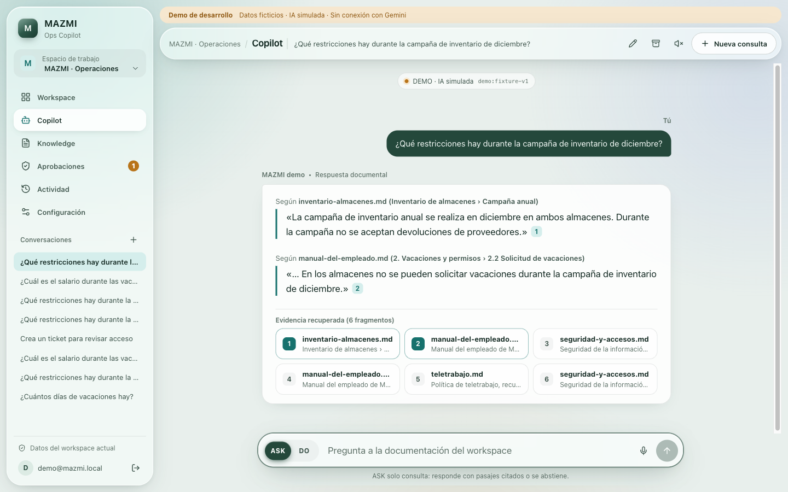
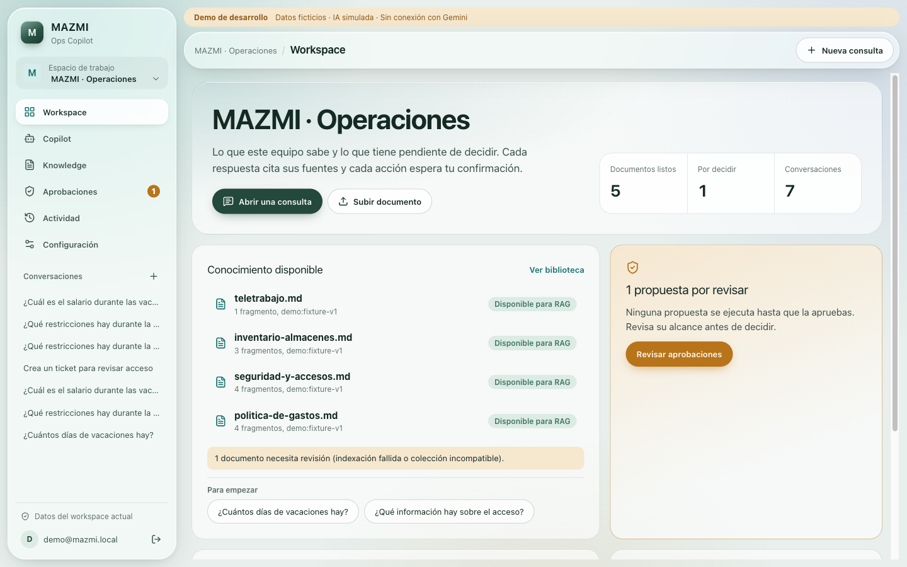
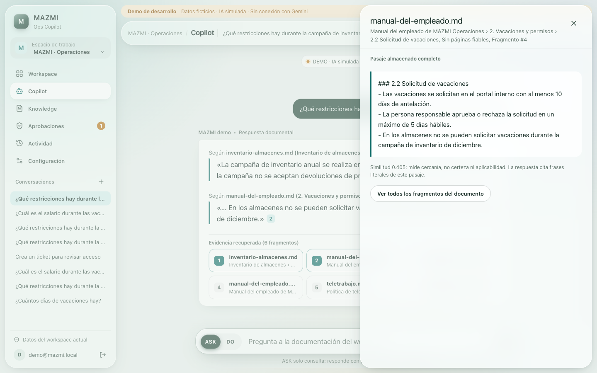
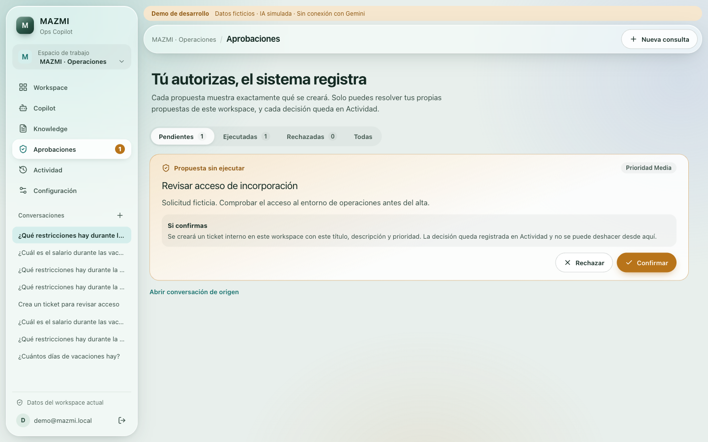
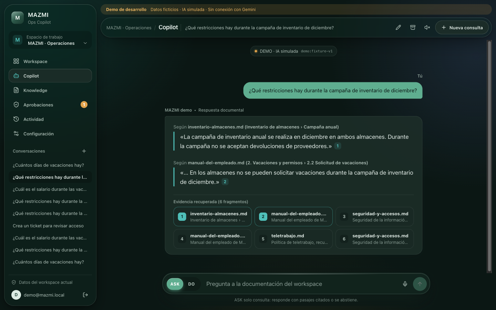
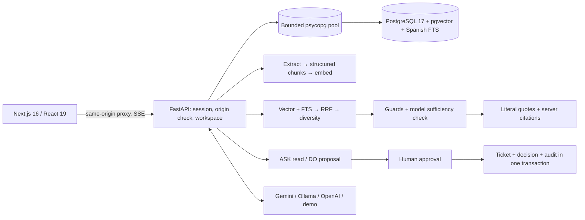

# MAZMI Ops Copilot

**Enterprise AI for document knowledge, evidence-backed answers and human-supervised actions.**

[](frontend/package-lock.json) [](frontend/package-lock.json) [](frontend/package-lock.json) [](backend/Dockerfile) [](backend/requirements.lock)
[](docker-compose.yml) [](docker-compose.yml) [](GEMINI.md) [](LOCAL_AI.md) [](backend/requirements.lock)
[](docker-compose.yml) [](.github/workflows/ci.yml)
[](https://github.com/LucaMZM/mazmi-ops-copilot/actions/workflows/ci.yml) [](LICENSE)


MAZMI answers questions from a team's own documents with **verifiable, literal citations**, abstains when the evidence is not enough, and prepares operational actions that **only run after a person approves them**. Everything is scoped to a workspace and recorded in an audit trail.

Built as a portfolio project with a direct Python RAG pipeline (no LangChain or agent framework), real PostgreSQL persistence and a deliberately small tool surface.

> **Status (9 Nov 2026, version 2.0 on branch `feat/ops-copilot-v2`):** 306 backend and 47 frontend tests pass against real PostgreSQL/pgvector. Retrieval and local-model results are measured and published with their failures in [VALIDATION.md](VALIDATION.md). The local Qwen3 4B model still does not meet the acceptance criteria, so there is no `v1.0.0` tag. Gemini, OpenAI and voice are implemented but not verified live. This is not a production deployment.

## Screenshots

Real captures of the production build running the clearly labelled deterministic demo ([provenance](docs/screenshots/README.md)).



| Workspace | Evidence inspector |
|---|---|
|  |  |

| Human approval | Dark theme |
|---|---|
|  |  |

[Knowledge](docs/screenshots/v2-knowledge.png) · [Activity](docs/screenshots/v2-activity.png) · [Settings](docs/screenshots/v2-settings.png) · [Mobile](docs/screenshots/v2-copilot-mobile.png)

## What 2.0 changed

| Area | Change | Evidence |
|---|---|---|
| Reliability | Exact ticket reads no longer require a model provider on the streaming endpoint; validation errors keep real HTTP codes | 6 HTTP regressions (3 failed before) |
| Transactions | No connection, lock or open transaction during embeddings or inference; one atomic final write that re-checks scope and cited chunks | Lock/`idle in transaction` tests that failed before |
| Idempotency | `client_request_id` replays a committed turn instead of creating a second proposal; safe retries from the UI | Sequential and concurrent tests |
| Streaming | asyncio SSE bridge, heartbeats, deadline, always one terminal event; robust browser parser | Unit tests (disconnect, timeout, split frames) |
| RAG | Structure-aware chunking, any-term Spanish FTS, per-document diversity, focused literal quotes with document and section | Retrieval ablation with real EmbeddingGemma |
| Frontend | Modular hooks and components; streaming draft isolated from history; conversations rename/archive | 47 tests, typecheck, lint, build |
| Design | Liquid Glass design system, light/dark, phone tab bar, reduced motion/transparency | Real browser checks |

## Architecture



A chat turn runs in five phases: **preflight** (tool gate, limits, provider requirements) → **short read** (conversation scope, history) → **query embedding without a connection, then SQL retrieval** → **provider work with no connection held** → **one atomic write** that re-checks the conversation, the cited chunks and the idempotency key before storing messages, proposal and audit. A disconnect or deadline rolls back the turn. In-flight provider calls are not interrupted; their results are discarded.

## RAG: how an answer is built

1. **Ingest.** PDF, DOCX, TXT or Markdown up to 20 MB. Text is split by structure: headings (Markdown, numbered, DOCX styles), paragraphs, list items and table rows stay whole; tables repeat their header; each chunk stores its section path. Page numbers come only from PDFs.
2. **Retrieve.** Exact cosine search and Spanish full-text search, both filtered by workspace, document state and embedding collection, fused with Reciprocal Rank Fusion, deduplicated, at most three chunks per document in the first pass.
3. **Assess.** Deterministic guards check scope, missing facts, relations, conditional premises and literal contradictions. A model then decides `sufficient / insufficient / conflicting` and selects passage ids through a strict JSON schema; it never writes the answer.
4. **Answer.** The server renders literal sentences from the selected passages with their origin, for example `Según manual.md (2.2 Solicitud de vacaciones): «…» [1]`, and creates the citation ids. The inspector shows the full stored passage. Otherwise it abstains and says why.

Documents are untrusted data: documentary calls never receive tools and tool calls never receive documents or history. Vectors are isolated by provider, model, dimension and revision; switching models requires explicit reindexing.

## Security controls

Opaque HttpOnly `SameSite=Strict` session cookies (hashed in the database), scrypt passwords, persistent login throttling, origin checks on every mutation, server-side workspace membership on every query, strict Pydantic models, sanitized provider errors, CSP and security headers, bounded uploads and DOCX decompression. ASK cannot mutate. DO only creates a proposal; only the requester in the same workspace can decide it, exactly once, and execution, decision and audit commit together.

## Run it locally

Prerequisites: Python 3.13, Node.js 22+, PostgreSQL 17 with pgvector. Keep virtualenvs, `node_modules` and database clusters outside synchronized folders (iCloud/Dropbox).

```bash
git clone https://github.com/LucaMZM/mazmi-ops-copilot.git
cd mazmi-ops-copilot
python3.13 -m venv .venv && source .venv/bin/activate
pip install -r backend/requirements.lock
test -e .env || cp .env.example .env
(cd frontend && npm ci)
```

For the **no-key demo** follow [DEMO.md](DEMO.md): it creates a dedicated `*_demo` database, seeds fictional documents and prints a one-time password locally. For the local-model profile see [LOCAL_AI.md](LOCAL_AI.md); for Gemini see [GEMINI.md](GEMINI.md). Before using an existing database read [database/MIGRATIONS.md](database/MIGRATIONS.md) (migration 005 is additive).

```bash
# Terminal 1
cd backend && python -m app.migrate && uvicorn app.main:app --host 127.0.0.1 --port 8000
# Terminal 2
cd frontend && npm run dev
```

## Tests and evaluations

```bash
cd backend
ruff check .
TEST_DATABASE_URL=postgresql://… pytest -q          # integration tests use isolated schemas
python -m app.evaluate_grounding                    # offline evidence-policy corpus
DATABASE_URL=postgresql://…/x_eval python -m app.evaluate_retrieval --embeddings synthetic --output /tmp/r.json
cd ../frontend
npm test && npm run typecheck && npm run lint && npm run build
```

Without `TEST_DATABASE_URL` the integration tests are skipped, never reported as passed. Normal tests never call a paid provider or download a model. Real-model evaluations (`app.evaluate_local --live`, `app.evaluate_retrieval --embeddings ollama`) are explicit and refuse non-dedicated databases.

## Measured results (summary)

- Retrieval, real EmbeddingGemma, 22 answerable questions: Recall@3 0.955 → **1.0**, full evidence@6 0.955 → **1.0**, MRR 0.977 → 0.977, with chunks about a third of the previous size.
- Qwen3 4B on 8 fixed cases: 2/4 positives, **4/4 correct abstentions**, 1 timeout and 1 incomplete assessment. A faster no-reasoning mode answered 4/4 positives in 176 s instead of 777 s but **accepted insufficient evidence twice**, so it stays opt-in.
- All 13 security journeys (isolation, requester checks, exactly-once approval, rejection without execution, audit) passed with the real model.

Full tables, categories and limits: [VALIDATION.md](VALIDATION.md).

## Limitations

Small synthetic evaluation corpora; no large-corpus or ANN benchmark. The local 4B model is slow and imperfect at sufficiency judgements on 8 GB. Live Gemini/OpenAI, voice and Docker Compose runtime are unverified. Indexing is synchronous (interrupted jobs are marked failed on restart). No email recovery, invitations or RBAC. Prompt-injection controls reduce specific risks; they are not a guarantee.

## License

**Proprietary — All Rights Reserved.** The original code is visible for portfolio evaluation only. Copying, modifying, redistributing, and commercial reuse require prior written permission. See [LICENSE](LICENSE). Third-party components retain their own licenses.
